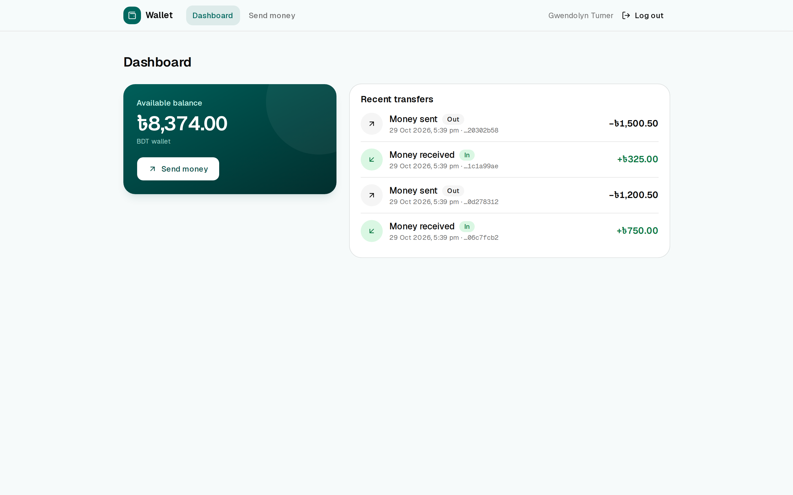
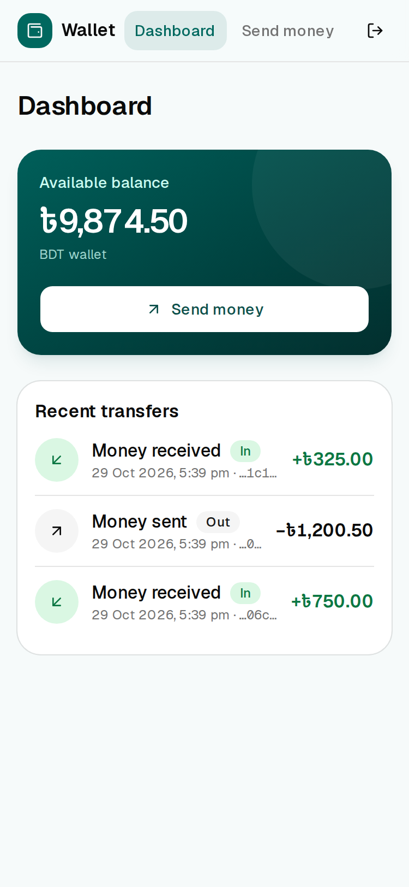
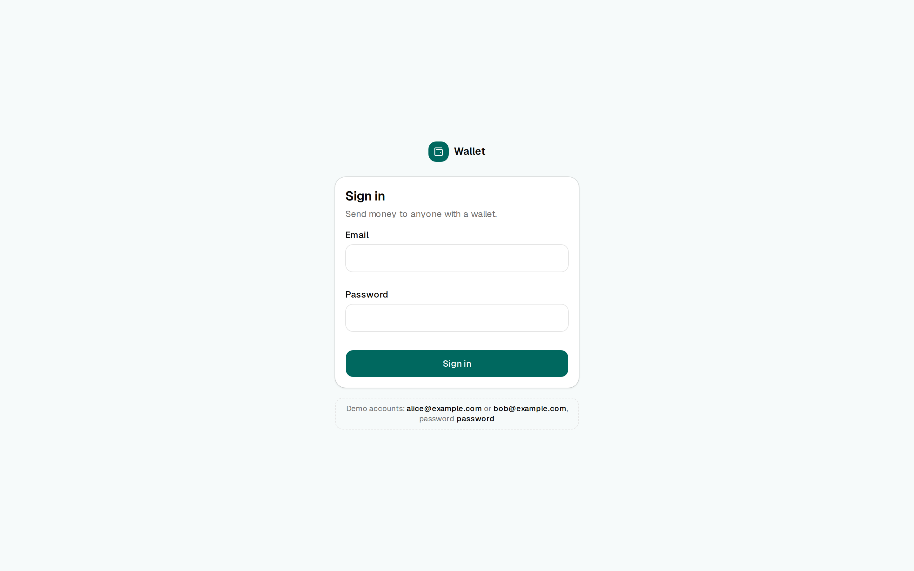
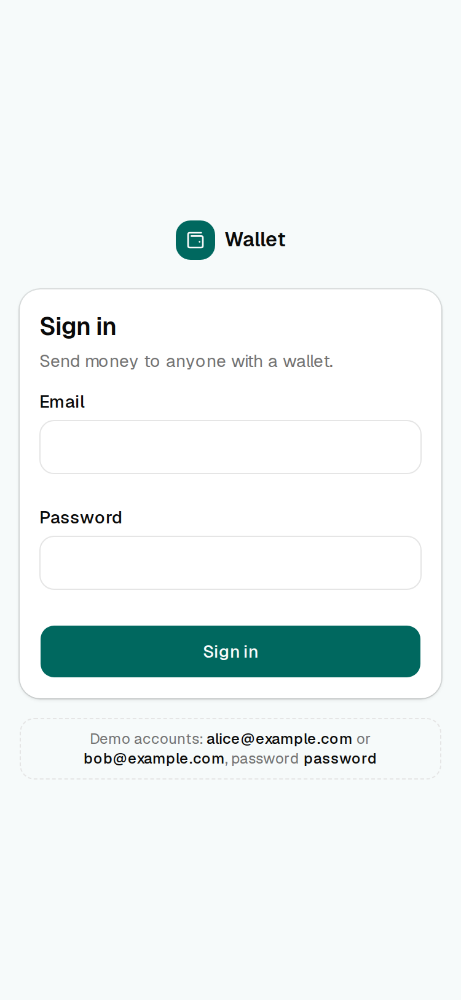
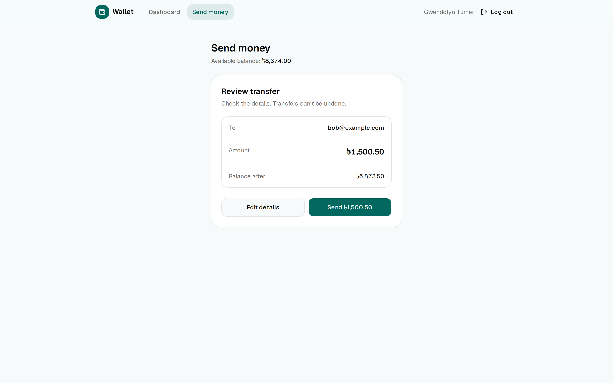
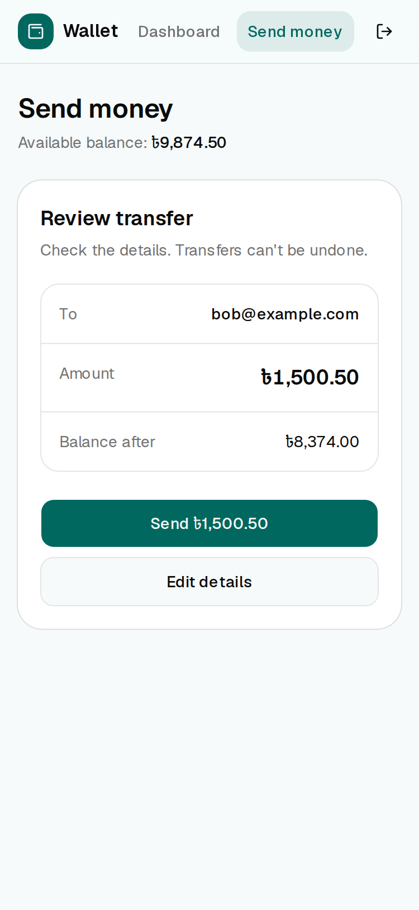
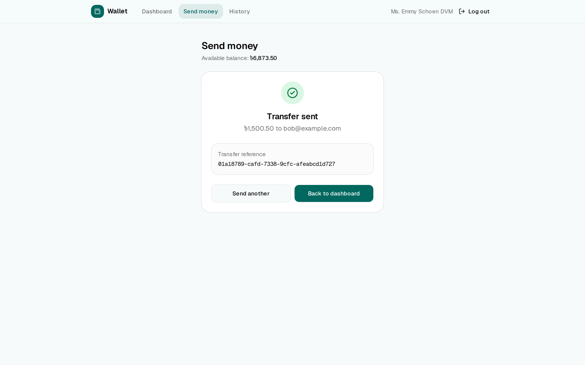
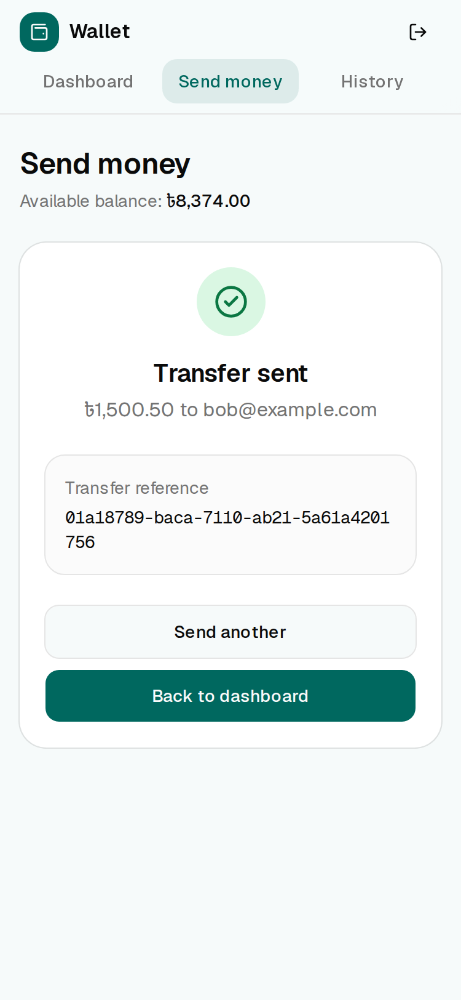
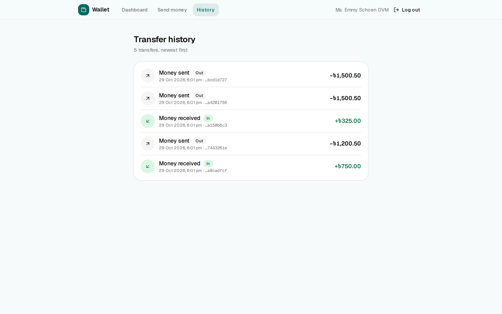
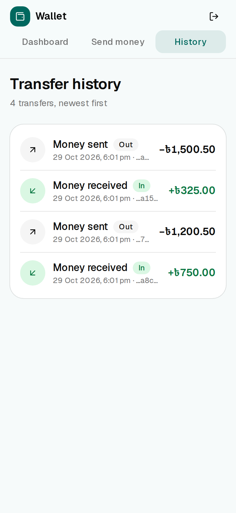

# wallet-transfer-web

A Next.js frontend for [laravel-wallet-transfer-api](https://github.com/Moulin-Talukder/laravel-wallet-transfer-api): sign in, check your balance, and send money to another wallet, safely and exactly once.

> **This is a standalone portfolio sample.** It is not employer or client code.
> It was built with [Claude Code](https://claude.com/claude-code) as an AI pair programmer. I reviewed every change,
> and verified it with unit and component tests, deliberately broken code to prove the tests can fail,
> an end-to-end test, and browser testing at 375px and 1440px, which found the bugs described [below](#bugs-found-by-browser-testing).

| Desktop | Mobile |
|---|---|
|  |  |

## Stack

- Next.js 16 (App Router, Cache Components, `proxy.ts`), React 19, TypeScript (strict)
- Tailwind CSS 4 and shadcn/ui
- react-hook-form + zod (schemas shared by the browser and the server)
- Vitest + React Testing Library; Playwright for the end-to-end test and screenshots

## Running it with the API

You need PHP 8.3+, Composer and Node.js 22.12+ (required by Vitest; developed on Node 24).

**1. The API** (in another directory):

```bash
git clone https://github.com/Moulin-Talukder/laravel-wallet-transfer-api.git
cd laravel-wallet-transfer-api
composer install
cp .env.example .env
php artisan key:generate
php artisan migrate --seed   # alice@example.com (10,000 BDT) and bob@example.com (2,500 BDT), password "password"
php artisan serve            # http://127.0.0.1:8000
```

**2. This app:**

```bash
npm install
cp .env.example .env.local   # API_URL=http://127.0.0.1:8000
npm run dev                  # http://localhost:3000
```

Sign in as `alice@example.com` / `password` and send money to `bob@example.com`.

The browser never calls the API directly (see below), so the API's CORS setting (`FRONTEND_URL`) doesn't matter for this app.

### Scripts

| Command | What it does |
|---|---|
| `npm run dev` | Development server |
| `npm run build && npm start` | Production build and server |
| `npm test` | Unit and component tests (Vitest) |
| `npm run test:e2e` | End-to-end test (Playwright); needs the API running |
| `npm run lint` | ESLint |
| `npm run typecheck` | Regenerates Next route types, then `tsc --noEmit` |
| `node scripts/capture-screenshots.mjs` | Recreates `docs/screenshots` from a running production build (see the script header) |

## Design decisions

### The token never reaches the browser (BFF pattern)

The Laravel API issues a Sanctum bearer token. Storing it in `localStorage` would make it readable by any script
on the page, so a single XSS bug would leak it. Instead, the Next.js server acts as a *backend for the frontend*:

```
Browser ──(Server Action / page request + httpOnly cookie)──▶ Next.js server ──(Bearer token)──▶ Laravel API
```

- **Login** is a Server Action. It sends the credentials to `POST /api/login`, stores the token in a cookie,
  and returns only `{ ok: true }`. The browser never sees the token.
- **The cookie** (`wt_session`) is `httpOnly` (no JavaScript access), `sameSite=lax` (not sent on cross-site POSTs),
  `secure` in production, and expires together with the token (24 hours, from the API's `expires_at`).
- **Server Components** read the cookie and fetch the balance and transfers on the server
  ([`lib/dal.ts`](lib/dal.ts)). [`lib/api/client.ts`](lib/api/client.ts) imports `server-only`,
  so importing it from client code is a build error.
- **Server Actions** are reachable by anyone who can send a POST, so `createTransfer` validates its input again with
  the same zod schema the form uses. Next.js checks the `Origin` header of every action (CSRF protection).
- **[`proxy.ts`](proxy.ts)** (Next 16's new name for middleware) redirects requests without a session cookie to
  `/login`. This is only an optimistic check: Laravel validates the token on every request.
- **On a 401** (expired or revoked token) the cookie must be cleared. Server Components are not allowed to modify cookies,
  so a page that gets a 401 redirects to [`/auth/expired`](app/auth/expired/route.ts), a Route Handler that clears
  the cookie and redirects to `/login?expired=1`. Server Actions clear the cookie themselves.

### Money is an integer, from input to API

Amounts are integer **paisa** (1 BDT = 100 paisa), as in the API. The amount field is a text input
(`inputMode="decimal"` for the phone keypad), and [`parseBdtToPaisa`](lib/money.ts) converts `"1,500.50"` to `150050`
with string and integer math only: `0.29 * 100` is `28.999999999999996` in floating point. More than 2 decimals,
negatives, exponents and misplaced commas are rejected rather than guessed. `formatPaisa(150000)` gives `৳1,500.00`.

### Idempotency on the client

The API deduplicates transfers by the `Idempotency-Key` header. The client's job is to send **the same key for the same
payment attempt**, and a new key for a new one ([`lib/idempotency.ts`](lib/idempotency.ts)):

- The key is created when the user first clicks **Send** and is bound to the payload (receiver + amount).
- Every retry of that payload reuses it: after a network error, a timeout, a 500, a 429, or after going back to "Edit details" without changing anything.
  If the first request actually succeeded and only the response was lost, the retry returns the original transfer
  (`200`, `Idempotent-Replayed: true`) and the success screen says so. **The user is never charged twice.**
- A new key is created only after a success, or when the receiver or amount changes.
- Double clicks are stopped three times over: the button is disabled while the request is in flight, a `ref` guard drops a second
  click in the same frame (before React re-renders), and Next.js runs Server Actions one at a time per client,
  so even a second request would arrive later with the same key and be a replay.
- `crypto.randomUUID()` only exists in secure contexts, so there is a `getRandomValues()` fallback for testing on a phone over plain HTTP.

### Errors are mapped once

[`toApiFailure`](lib/api/parse.ts) turns every Laravel response into one typed union (`validation`, `business` + code,
`unauthenticated`, `forbidden`, `rate_limited` + Retry-After, `network`, `server`). The UI branches on that,
never on status numbers or message strings:

| API response | What the user sees |
|---|---|
| 422 `INSUFFICIENT_BALANCE` | "Your balance is too low for this transfer. Try a smaller amount." |
| 422 `SAME_WALLET` | "You can't send money to yourself." |
| 422 `RECEIVER_UNAVAILABLE` | "This account can't receive transfers right now." |
| 422 `SENDER_FROZEN`, 403 | "Sending money is disabled on your wallet. Please contact support." |
| 422 `IDEMPOTENCY_KEY_REUSED` | "Review the transfer and send it again." (and the key is rotated) |
| 422 field errors | Shown under the matching form field, e.g. "We couldn't find an account with that email." |
| 429 + `Retry-After: 42` | "Please wait 42 seconds and try again." |
| Network error, timeout, 5xx | "We couldn't confirm the transfer. Trying again is safe: you won't be charged twice." |

### Accessibility

Labels on every input, visible focus rings, a skip link, `aria-current` in the nav, and `aria-invalid` +
`aria-describedby` on invalid fields. Field errors live in always-present `aria-live` regions, so screen readers announce them,
and alerts use `role="alert"`. Focus moves to each step's heading (edit → review → success) and to the first invalid field.

### Streaming instead of spinners

With Cache Components, each page is a *partial prerender*: the header, headings and skeletons are static HTML, and the
balance and transfers stream into `<Suspense>` boundaries. Balances are never cached.

## Bugs found by browser testing

The code compiled, passed type checking and linting, and looked right on review. Walking through every flow in a real
browser (Playwright, at 375px and 1440px), and later looking closely at the README screenshots, found five bugs that none
of those checks catch:

1. **`redirect()` inside a Server Action called from an event handler.** Login originally called `redirect("/dashboard")`
   in the action. When the form awaits an action from a click handler, the redirect reaches the client as a *rejected promise*,
   so the form's `catch` block put a "Can't reach the server" error into the (now hidden) login page, right after a
   successful login. **Fix:** actions called from event handlers return a result, and the client navigates with
   `router.replace()`. The logout button is a plain `<form action>`, where Next.js handles `redirect()` natively.

2. **Next.js keeps visited pages mounted in a hidden `<Activity>`.** After login, the password was still in the hidden login form's
   DOM, and the transfer page reopened on the previous "Transfer sent" screen. **Fix:** the login form resets itself
   before navigating, and the transfer form resets in an effect cleanup, which React runs when the page is hidden.

3. **Mobile layout at 375px.** The dashboard scrolled sideways by 7px, because a single-column grid track defaults to `auto`
   and long transfer rows set its minimum width (`grid-cols-1` is `minmax(0, 1fr)`). The review buttons collapsed to
   about 20px tall, because `flex-1` in a column layout sets their height basis to 0. "Send money" wrapped in the header.
   Later, adding a third nav link (History) made the header 438px wide; on phones the nav now wraps onto its own row of tabs.

4. **The taka sign (৳) rendered small and misaligned.** Geist has no ৳ glyph, so the browser fell back to a system font.
   **Fix:** Noto Sans Bengali as a fallback font, loaded through `next/font` for the Bengali `unicode-range` only, so it renders just that glyph.

5. **Every transfer row showed the same reference.** The list showed the first 8 characters of each reference, but the API
   uses UUIDv7, whose leading characters are a timestamp, so transfers made in the same minute looked identical.
   **Fix:** show the last 8 characters, which are random.

Each fix was confirmed with the same browser walkthrough: no stale error after login, an empty password field after logout,
a fresh form when reopening "Send money", and a page exactly 375px wide. Fixes 4 and 5 were confirmed by re-capturing the screenshots.

## Tests

```bash
npm test           # 107 unit and component tests
npm run test:e2e   # end-to-end test; start the API first
```

- **Unit:** paisa ↔ BDT formatting and parsing ([`money.test.ts`](lib/money.test.ts)), form schema limits,
  Laravel response parsing and Retry-After, the message for every error code ([`errors.test.ts`](lib/errors.test.ts)),
  idempotency key reuse and rotation ([`idempotency.test.ts`](lib/idempotency.test.ts)), and the `?page=` parameter.
- **Component** ([`transfer-form.test.tsx`](components/transfer-form.test.tsx)): validation, the disabled state while submitting
  (a double click calls the action once), every error type shown to the user, and key reuse through the real UI:
  network error → 429 → success sends `key-1` three times; changing the amount sends `key-2`.
- **End-to-end** ([`e2e/send-money.spec.ts`](e2e/send-money.spec.ts)): against the production build and the real API, at 1440px and 375px.
  It signs in, sends a random amount to Bob through the review step, finds the reference from the success screen as the
  newest row in the history, and checks that the balance dropped by exactly that amount. Playwright builds and starts the app on port 3100;
  the Laravel API must already be running.

To check that the tests can fail, I broke the code three times and confirmed the matching tests failed:
a key store that always creates a new key, removing the in-flight guard and disabled state, and showing raw server
messages instead of the mapped ones. For the end-to-end test, I made the server action send 1 paisa more than the user
entered; the test failed on the history row (expected ৳92.45, found ৳92.46).

## Security notes

- The token lives only in an `httpOnly` cookie and on the Next.js server; nothing is stored in `localStorage`.
- `API_URL` is a server-only environment variable (no `NEXT_PUBLIC_` prefix). `.env.local` is git-ignored; `.env.example` is committed.
- `npm audit` reports 3 low-severity advisories for `deepmerge` (prototype poisoning), pulled in by the **shadcn CLI**
  (`shadcn` → `@shadcn/registry` → `deepmerge`). This is build tooling used to add components. It never runs in the
  app and is not part of the browser bundle. `npm audit fix --force` would downgrade shadcn to 1.0, so it is left as is.

## Known limitations

- **Login rate limiting behind the BFF.** The API limits logins per email *and IP address*. All requests now come from the
  Next.js server's IP, so the limit is effectively per email, shared by everyone: 5 wrong passwords lock that email out
  for a minute. The fix is to forward the client IP in `X-Forwarded-For` and configure trusted proxies in Laravel.
- **No counterparty in the transfer list.** The API's transfer resource doesn't include the other party's email,
  so rows show the direction, amount, date and reference.

## Project structure

```
app/
  login/                  sign-in page
  (app)/                  authenticated shell: header, nav, logout, error boundary
    dashboard/            balance + 5 most recent transfers
    transfers/            full history, 20 per page (?page=2)
    transfers/new/        send money (edit → review → success)
  auth/expired/route.ts   clears the cookie after a 401
components/               BalanceCard, AmountInput, TransferForm, TransferList,
                          TransferStatusBadge, ErrorAlert, LoginForm, ...
lib/
  actions/                Server Actions (login, logout, createTransfer)
  api/                    server-only API client, response types and error parsing
  dal.ts                  data access for Server Components
  money.ts                paisa ↔ BDT
  idempotency.ts          one Idempotency-Key per payment attempt
  errors.ts               ApiFailure → user-facing message
e2e/                      Playwright end-to-end test
proxy.ts                  redirects requests without a session to /login
```

## Screenshots

Captured from the production build with [`scripts/capture-screenshots.mjs`](scripts/capture-screenshots.mjs).

| | Desktop (1440px) | Mobile (375px) |
|---|---|---|
| Sign in |  |  |
| Dashboard |  |  |
| Review |  |  |
| Success |  |  |
| History |  |  |
